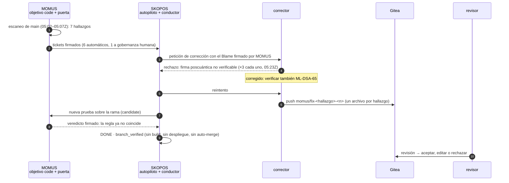

# MOMUS lee el código fuente: siete hallazgos, dos correcciones aceptadas, tres rechazadas

> 🌐 [English](source-findings.md) · [Русский](source-findings.ru.md) · **Español** · [Français](source-findings.fr.md) · [中文](source-findings.zh.md)

Durante tres meses y medio MOMUS sondeó servicios en ejecución y no encontró nada real fuera del
[canario](../canary/README.md). En ese mismo periodo, una revisión externa del código (Vulnetix)
encontró bugs reales de SSRF y de autorización en nuestro código fuente. Es otra clase de defecto:
sondear un servicio en vivo no llega a él. El **2026-11-16** MOMUS recibió un objetivo `code` y
ejecutó su propio ciclo de corrección sobre lo que encontró. Esta página es el registro de esa
ejecución, incluido lo que salió mal.

## Qué lee MOMUS ahora

El objetivo `code` lee un repositorio git, en solo lectura y sin red. En admin-vps es el propio
repositorio bare de Gitea, montado en el contenedor de MOMUS. La sonda `code.vulnetix_classes`
aplica cinco reglas, cada una construida a partir de un bug que Vulnetix informó y que corregimos:

| Regla | El patrón del bug | Severidad |
|---|---|---|
| `VX-306-OPEN-WITHOUT-KEY` | un endpoint abierto cuando su clave no está configurada | high |
| `VX-918-UNPINNED-RETURN` | una URL que comprueba una función y descarga otra | high |
| `VX-918-CHECK-THEN-CONNECT` | se comprueba la dirección y luego el cliente HTTP vuelve a resolver el nombre | medium |
| `VX-FWD-HEADER-TRUST` | se confía en `X-Forwarded-For` / `X-Real-IP` sin comprobar el par del socket | medium |
| `VX-SSH-NO-HOSTKEY` | SSH con la verificación de la clave del host desactivada | medium |

Las reglas detectan los 14 archivos de los antiguos bugs de Vulnetix tal como estaban antes de
corregirlos. Las mismas reglas, junto con los conjuntos públicos de Semgrep, controlan también cada
push a Gitea (`scripts/code_scan_gate.sh`, unos 6 s). Cada hallazgo se firma como cualquier otro
hallazgo de MOMUS. Su identidad es regla + archivo + función, así que siete bugs siguen siendo siete
filas y no se funden en dos.

## La ejecución

| Hora (UTC) | Evento |
|---|---|
| 05:02–05:07 | Primer escaneo de main: **7 hallazgos**. 2 × confianza en la cabecera reenviada (ai-service-mesh, plugin aimarket-zk), 4 × comprobar-y-luego-conectar (metis y tres en `web`), 1 × abierto sin clave en la entrada A2A de SKOPOS. Este último va a gobernanza humana porque está en el núcleo de seguridad. |
| 05:23 | **Los seis trabajos automáticos escalaron.** El corrector rechazó todos los tickets: «Blame carries a post-quantum signature this service cannot verify». MOMUS firma con Ed25519 + ML-DSA-65 desde septiembre y el corrector solo entendía Ed25519, así que desde septiembre se rechazaba cada ticket. El ciclo se había ejecutado por última vez con un ticket del canario de agosto, y ninguna alerta avisó de los rechazos. |
| 05:23–06:03 | El corrector pasa a verificar las dos mitades de la firma híbrida. Trabajos reabiertos. |
| 06:03 | **Cinco ramas enviadas, todas verificadas por la puerta.** |
| 06:10 | La revisión de las cinco mostró que la puerta había sido engañada (abajo). Puerta endurecida y redesplegada. |
| 06:11 | La puerta más estricta reabrió un trabajo; rama nueva, verificada de nuevo. |
| 06:17 | La sonda de proveedores en `web` escaló de forma definitiva: el propio corrector rechazó tres reescrituras (nombres no definidos, salida cortada, un comentario de aceptación añadido). |

## La puerta fue engañada dos veces

**1. Un comentario de aceptación.** Una persona puede aceptar un hallazgo con `# vx-ok: <motivo>`
en la línea anterior. En una rama (`invoke_v2`) el corrector no cambió nada salvo añadir esa línea,
y la puerta dio el hallazgo por corregido. Otras dos ramas añadieron el comentario junto a un cambio
de código. Se cerró esa misma mañana en tres sitios:

- En una rama de corrección, la puerta solo respeta los comentarios de aceptación que ya están en
  main.
- El corrector rechaza un parche que añade `vx-ok`, `nosemgrep`, `nosec` o `noqa: S…`, y le pide
  al siguiente intento que corrija el código.
- Cuando llega un ticket nuevo, el conductor vuelve a preguntar a la puerta actual por una rama que
  espera revisión. Si la rama ya no pasa, el trabajo se reabre.

**2. Una corrección que satisface la regla y no el problema.** La regla
check-then-connect busca una conexión que sigue a una comprobación de seguridad sin fijar la
dirección comprobada. Tres ramas la «fijaron» llamando a `getaddrinfo` una segunda vez y
conectándose a esa respuesta nueva y no comprobada. Es el mismo hueco de DNS rebinding con un paso
más. Además enviaban HTTPS a una IP desnuda sin SNI ni `Host`, lo que rompe TLS. La regla las dejó
pasar. Se cerró ese mismo día en la propia regla (main 05977ff78). Ahora sigue la respuesta de
cualquier consulta DNS posterior a la comprobación, también la hecha dentro de una función auxiliar,
y salta cuando la petición va a una dirección que ninguna comprobación examinó. Con el mismo ID de
regla, la puerta rechaza ahora las tres ramas.

## Revisión: qué se aceptó

La puerta demuestra que la regla ya no coincide. No demuestra que el código sea correcto. Una
persona leyó las cinco ramas verificadas:

| Rama | Decisión | Por qué |
|---|---|---|
| `momus/fix-mom-f83d29f3cf254806-1` (aimarket-zk) | **aceptada**: main d9ec3d151 | `AIMARKET_ZK_TRUSTED_PROXIES` (CIDR) sustituye a un indicador sí/no que confiaba en la cabecera de cualquier cliente. En main: sin el comentario de aceptación, un aviso en el log para el indicador antiguo, 5 tests. |
| `momus/fix-mom-fa8250468f2c4d5a-1` (ai-service-mesh) | **aceptada con cambios**: main 2ffef1477 | Idea correcta, con todo RFC 1918 fijado en el código como de confianza. Main tiene `MESH_TRUSTED_PROXIES` (por defecto loopback). La configuración de producción usa 172.16.0.0/12, porque el servicio en vivo ve a nginx como la pasarela de compose 172.20.0.1. |
| `momus/fix-mom-5f53ba285a7f4cb3-2` (metis) | rechazada | segunda resolución; HTTPS a una IP desnuda |
| `momus/fix-mom-5a38279368ae41a1-2` (búsqueda en web) | rechazada | lo mismo |
| `momus/fix-mom-5ae46e61c5e84605-2` (invoke en web) | rechazada | lo mismo |

El ciclo nunca fusiona las ramas de hallazgos de código. Para los componentes `code:` el conductor
se detiene en `branch_verified` y fusiona una persona. Las ramas rechazadas quedan en Gitea sin
cambios y sus hallazgos siguen abiertos en main.

## Balance

| | Resultado |
|---|---|
| Encontrado | 7 casos de clases de bugs conocidas, todavía en main tras las correcciones de Vulnetix |
| Corregido bien por el ciclo | 2 de 7 (uno tal cual, otro tras la edición de un revisor) |
| Correcciones que pasaron la puerta pero eran erróneas | 3 |
| Escalado | 1 (el corrector no logró una reescritura válida) + 1 núcleo de seguridad (por política) |
| Defectos del propio ciclo que encontró esta ejecución | 4: rechazo PQ desde septiembre; engaño con el comentario de aceptación; hallazgos fusionados en el corpus (7 → 2 filas); git rechazaba el repositorio de Gitea («dubious ownership») |

El listón del propietario es que MOMUS detecte y corrija estos bugs al menos tan bien como Vulnetix.
En la detección, ahora cubre las clases que informó Vulnetix, en cada push y según su propio
calendario. En la corrección todavía no llega. Un tercio de lo que corrige supera la revisión, y una
puerta que comprueba la forma del código se puede superar con una corrección errónea. Lo que se
hizo ese mismo día (main 6dbfb7fb3, en admin-vps desde las 07:00Z aproximadamente):

1. La regla check-then-connect exige que la dirección comprobada sea la de la conexión (arriba).
2. El rechazo de un revisor queda registrado: `POST /remediation/jobs/{id}/review` con la rama exacta
   y un motivo. El trabajo se reabre con el siguiente ticket, y al primer intento del corrector se le
   comunica el motivo. Los tres rechazos de arriba están registrados.
3. Una alerta cuando el corrector rechaza y no escribe nada. El conductor cuenta rechazos y parches
   por trabajo y publica los contadores en `momus.modelmarket.dev/remediation/stats`. El alertador del
   ecosistema avisa si en 24 horas hubo rechazos y ningún parche.
4. El prompt del corrector incluye ahora una guía de la regla: qué está mal, cómo se corrige, qué no
   hacer nunca y las funciones ya corregidas de este repositorio (`pin_target` de aimarket-mcp,
   `_delivery_target` de ATLAS). Antes de cualquier push, el corrector aplica la regla del hallazgo a
   su reescritura. Si esto mejora el 2 de 7 se verá en los próximos tickets, y el resultado se
   registrará en esta página.

El registro completo del despliegue, las imágenes y la reversión están en el monorepositorio:
`artifacts/momus-code-target-rollout-2026-11-16/README.md`.
