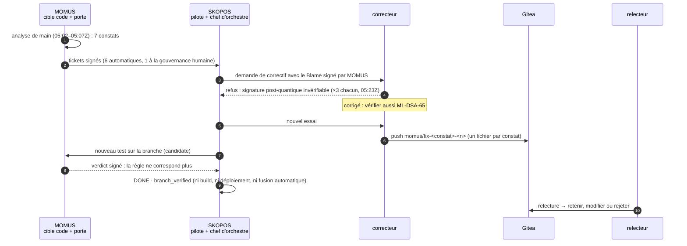

# MOMUS lit le code source : sept constats, deux correctifs retenus, trois rejetés

> 🌐 [English](source-findings.md) · [Русский](source-findings.ru.md) · [Español](source-findings.es.md) · **Français** · [中文](source-findings.zh.md)

Pendant trois mois et demi, MOMUS a sondé des services en production sans rien trouver de réel en
dehors du [canari](../canary/README.md). Sur la même période, une revue de code externe (Vulnetix)
a trouvé de vrais bugs SSRF et d'autorisation dans notre code source. C'est une autre classe de
défaut, hors de portée d'une sonde sur un service en production. Le **2026-11-16**, MOMUS a reçu une
cible `code` et a fait tourner sa propre boucle de correction sur ce qu'il a trouvé. Cette page
consigne cette exécution, y compris ce qui a mal tourné.

## Ce que MOMUS lit désormais

La cible `code` lit un dépôt git, en lecture seule et sans réseau. Sur admin-vps, c'est le dépôt
bare de Gitea lui-même, monté dans le conteneur de MOMUS. La sonde `code.vulnetix_classes` applique
cinq règles, chacune tirée d'un bug signalé par Vulnetix et que nous avions corrigé :

| Règle | Le motif du bug | Gravité |
|---|---|---|
| `VX-306-OPEN-WITHOUT-KEY` | un endpoint ouvert quand sa clé n'est pas configurée | high |
| `VX-918-UNPINNED-RETURN` | une URL vérifiée par une fonction et récupérée par une autre | high |
| `VX-918-CHECK-THEN-CONNECT` | l'adresse est vérifiée, puis le client HTTP résout le nom à nouveau | medium |
| `VX-FWD-HEADER-TRUST` | `X-Forwarded-For` / `X-Real-IP` acceptés sans vérifier le pair de la socket | medium |
| `VX-SSH-NO-HOSTKEY` | SSH avec la vérification de la clé d'hôte désactivée | medium |

Les règles détectent les 14 fichiers des anciens bugs Vulnetix dans leur état d'avant correction.
Ces mêmes règles, avec les jeux publics de Semgrep, contrôlent aussi chaque push vers Gitea
(`scripts/code_scan_gate.sh`, environ 6 s). Chaque constat est signé comme tout constat de MOMUS.
Son identité est règle + fichier + fonction : sept bugs restent sept lignes et ne fusionnent pas en
deux.

## L'exécution

| Heure (UTC) | Événement |
|---|---|
| 05:02–05:07 | Première analyse de main : **7 constats**. 2 × confiance dans l'en-tête transmis (ai-service-mesh, plugin aimarket-zk), 4 × vérifier-puis-connecter (metis et trois dans `web`), 1 × ouvert sans clé dans l'entrée A2A de SKOPOS. Ce dernier part à la gouvernance humaine, car il relève du noyau de sécurité. |
| 05:23 | **Les six tâches automatiques ont été escaladées.** Le correcteur a refusé chaque ticket : « Blame carries a post-quantum signature this service cannot verify ». MOMUS signe en Ed25519 + ML-DSA-65 depuis septembre, et le correcteur ne comprenait que Ed25519 : chaque ticket depuis septembre avait été refusé. La boucle avait tourné pour la dernière fois sur un ticket du canari d'août, et aucune alerte n'avait signalé ces refus. |
| 05:23–06:03 | Le correcteur vérifie désormais les deux moitiés de la signature hybride. Tâches rouvertes. |
| 06:03 | **Cinq branches poussées, toutes validées par la porte.** |
| 06:10 | La relecture des cinq a montré que la porte avait été trompée (ci-dessous). Porte durcie et redéployée. |
| 06:11 | La porte plus stricte a rouvert une tâche ; nouvelle branche, validée à nouveau. |
| 06:17 | La sonde des fournisseurs dans `web` a été escaladée pour de bon : le correcteur a lui-même refusé trois réécritures (noms non définis, sortie tronquée, commentaire d'acceptation ajouté). |

## La porte a été trompée deux fois

**1. Un commentaire d'acceptation.** Une personne peut accepter un constat avec
`# vx-ok: <raison>` sur la ligne précédente. Sur une branche (`invoke_v2`), le correcteur n'a rien
changé d'autre qu'ajouter cette ligne, et la porte a compté le constat comme corrigé. Deux autres
branches ont ajouté le commentaire à côté d'une modification du code. Fermé le matin même, à trois
endroits :

- Sur une branche de correction, la porte ne tient compte que des commentaires d'acceptation déjà
  présents sur main.
- Le correcteur refuse un patch qui ajoute `vx-ok`, `nosemgrep`, `nosec` ou `noqa: S…`, et demande
  à la tentative suivante de corriger le code.
- À l'arrivée d'un nouveau ticket, le chef d'orchestre interroge de nouveau la porte actuelle sur une
  branche en attente de relecture. Si la branche ne passe plus, la tâche est rouverte.

**2. Un correctif qui satisfait la règle et non le problème.** La règle
check-then-connect cherche une connexion qui suit un contrôle de sécurité sans épingler l'adresse
vérifiée. Trois branches l'ont « épinglée » en appelant `getaddrinfo` une seconde fois, puis en se
connectant à cette nouvelle réponse, non vérifiée. C'est la même faille de DNS rebinding, avec une
étape de plus. Elles envoyaient en outre du HTTPS vers une IP nue sans SNI ni `Host`, ce qui casse
TLS. La règle les a laissées passer. C'est corrigé le jour même dans la règle elle-même (main
05977ff78). Elle suit désormais la réponse de toute requête DNS postérieure au contrôle, y compris
dans une fonction auxiliaire, et se déclenche quand la requête part vers une adresse qu'aucun
contrôle n'a examinée. Avec le même identifiant de règle, la porte rejette maintenant les trois
branches.

## Relecture : ce qui a été retenu

La porte prouve que la règle ne correspond plus. Elle ne prouve pas que le code est juste. Une
personne a lu les cinq branches validées :

| Branche | Décision | Pourquoi |
|---|---|---|
| `momus/fix-mom-f83d29f3cf254806-1` (aimarket-zk) | **retenue** : main d9ec3d151 | `AIMARKET_ZK_TRUSTED_PROXIES` (CIDR) remplace un drapeau oui/non qui faisait confiance à l'en-tête de n'importe quel client. Dans main : commentaire d'acceptation retiré, un avertissement dans le journal pour l'ancien drapeau, 5 tests. |
| `momus/fix-mom-fa8250468f2c4d5a-1` (ai-service-mesh) | **retenue avec modifications** : main 2ffef1477 | Bonne idée, mais tout RFC 1918 était codé en dur comme fiable. Main a `MESH_TRUSTED_PROXIES` (loopback par défaut). La surcouche de production fixe 172.16.0.0/12, car le service en production voit nginx comme la passerelle compose 172.20.0.1. |
| `momus/fix-mom-5f53ba285a7f4cb3-2` (metis) | rejetée | seconde résolution ; HTTPS vers une IP nue |
| `momus/fix-mom-5a38279368ae41a1-2` (recherche web) | rejetée | idem |
| `momus/fix-mom-5ae46e61c5e84605-2` (invoke web) | rejetée | idem |

La boucle ne fusionne jamais les branches des constats de code. Pour les composants `code:`, le chef
d'orchestre s'arrête à `branch_verified` et c'est une personne qui fusionne. Les branches rejetées
restent telles quelles dans Gitea, et leurs constats restent ouverts sur main.

## Bilan

| | Résultat |
|---|---|
| Trouvé | 7 occurrences de classes de bugs connues, toujours sur main après les corrections Vulnetix |
| Corrigé correctement par la boucle | 2 sur 7 (l'une telle quelle, l'autre après une modification du relecteur) |
| Correctifs passés par la porte mais faux | 3 |
| Escaladé | 1 (le correcteur n'a pas produit de réécriture valide) + 1 noyau de sécurité (par politique) |
| Défauts de la boucle elle-même révélés par cette exécution | 4 : refus PQ depuis septembre ; contournement par commentaire d'acceptation ; constats fusionnés dans le corpus (7 → 2 lignes) ; git refusant le dépôt de Gitea (« dubious ownership ») |

L'exigence du propriétaire : MOMUS doit détecter et corriger ces bugs au moins aussi bien que
Vulnetix. Pour la détection, il couvre désormais les classes signalées par Vulnetix, à chaque push
et selon son propre calendrier. Pour la correction, il n'y est pas encore. Un tiers de ce qu'il
corrige survit à la relecture, et une porte qui contrôle la forme du code peut être franchie par un
correctif faux. Ce qui a été fait le jour même (main 6dbfb7fb3, sur admin-vps depuis 07:00Z
environ) :

1. La règle check-then-connect exige que l'adresse vérifiée soit celle de la connexion (ci-dessus).
2. Le rejet d'un relecteur est enregistré : `POST /remediation/jobs/{id}/review` avec la branche
   exacte et un motif. La tâche est rouverte au ticket suivant, et la première tentative du
   correcteur reçoit ce motif. Les trois rejets ci-dessus sont enregistrés.
3. Une alerte quand le correcteur refuse sans rien écrire. Le chef d'orchestre compte les refus et
   les patchs par tâche et publie ces compteurs sur `momus.modelmarket.dev/remediation/stats`.
   L'alerteur de l'écosystème prévient si 24 heures contiennent des refus et aucun patch.
4. Le prompt du correcteur contient maintenant un guide de la règle : ce qui ne va pas, la
   correction, ce qu'il ne faut jamais faire, et les fonctions déjà corrigées de ce dépôt
   (`pin_target` d'aimarket-mcp, `_delivery_target` d'ATLAS). Avant tout push, le correcteur
   applique la règle du constat à sa réécriture. Les prochains tickets montreront si cela améliore
   le 2 sur 7, et le résultat sera consigné sur cette page.

Le dossier complet du déploiement, les images et le retour arrière se trouvent dans le monodépôt :
`artifacts/momus-code-target-rollout-2026-11-16/README.md`.
