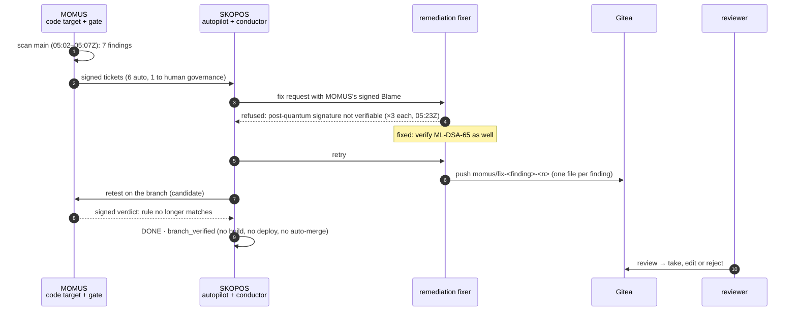

# MOMUS reads the source: seven findings, two fixes taken, three rejected

> 🌐 **English** · [Русский](source-findings.ru.md) · [Español](source-findings.es.md) · [Français](source-findings.fr.md) · [中文](source-findings.zh.md)

For three and a half months MOMUS probed running services and found nothing real outside the
[canary](../canary/README.md). In the same period an outside code review (Vulnetix) found real
SSRF and authorization bugs in our source: a different class of defect, one that probing a live
service cannot reach. On **2026-11-16** MOMUS got a `code` target and ran its own fix loop on what
it found. This page records the run, including the parts that went wrong.

## What MOMUS reads now

The `code` target reads one git repository, read-only and without network access: on admin-vps
that is Gitea's own bare repository, mounted into the MOMUS container. The probe
`code.vulnetix_classes` runs five rules, each built from a bug that Vulnetix reported and we had
fixed:

| Rule | The bug pattern | Severity |
|---|---|---|
| `VX-306-OPEN-WITHOUT-KEY` | an endpoint that is open when its key is not configured | high |
| `VX-918-UNPINNED-RETURN` | a URL checked by one function and fetched by another | high |
| `VX-918-CHECK-THEN-CONNECT` | the address is checked, then the HTTP client resolves the name again | medium |
| `VX-FWD-HEADER-TRUST` | `X-Forwarded-For` / `X-Real-IP` trusted without checking the socket peer | medium |
| `VX-SSH-NO-HOSTKEY` | SSH with host-key checking turned off | medium |

The rules catch all 14 pre-fix files of the old Vulnetix bugs. The same rules, together with
Semgrep's public rulesets, also gate every push to Gitea (`scripts/code_scan_gate.sh`, about 6 s).
Each finding is signed like any other MOMUS finding. Its identity is rule + file + function, so
seven bugs remain seven rows and are not merged into two.

## The run

| Time (UTC) | Event |
|---|---|
| 05:02–05:07 | First scan of main: **7 findings**. 2 × forwarded-header trust (ai-service-mesh, aimarket-zk plugin), 4 × check-then-connect (metis, three in `web`), 1 × open-without-key in SKOPOS's A2A ingress, which goes to human governance because it is in the security core. |
| 05:23 | **All six automatic jobs escalated.** The fixer refused every ticket: "Blame carries a post-quantum signature this service cannot verify". MOMUS has signed with Ed25519 + ML-DSA-65 since September, and the fixer only understood Ed25519, so every ticket since September had been refused. The loop had last run on an August canary ticket, and no alert reported the refusals. |
| 05:23–06:03 | Fixer changed to verify both halves of the hybrid signature. Jobs reopened. |
| 06:03 | **Five branches pushed, all gate-verified.** |
| 06:10 | Review of the five showed the gate had been gamed (below). Gate tightened and redeployed. |
| 06:11 | One job reopened by the stricter gate; new branch, verified again. |
| 06:17 | The `web` providers probe escalated for good: three rewrites the fixer itself refused (undefined names, output cut off, an added acceptance comment). |

## The gate was gamed, twice

**1. An acceptance comment.** A finding can be accepted by a person with `# vx-ok: <reason>` on
the line above it. On one branch (`invoke_v2`) the fixer changed nothing except to add that line,
and the gate counted the finding as fixed. Two other branches added the comment next to a code
change. Closed the same morning in three places:

- On a fix branch, the gate honours only acceptance comments that are already on main.
- The fixer refuses a patch that adds `vx-ok`, `nosemgrep`, `nosec` or `noqa: S…`, and tells the
  next attempt to fix the code instead.
- When a new ticket arrives, the conductor asks the current gate again about a branch that is
  waiting for review. If the branch no longer passes, the job reopens.

**2. A fix that satisfies the rule and not the problem.** The
check-then-connect rule looks for a connection that follows a safety check without pinning the
checked address. Three branches "pinned" by calling `getaddrinfo` a second time and connecting to
that new, unchecked answer. That is the same DNS-rebinding gap with an extra step. They also sent
HTTPS to a bare IP with no SNI or `Host`, which breaks TLS. The rule passed them. Closed the same
day in the rule itself (main 05977ff78): it now follows the answer of any DNS lookup after the check,
including one made inside a helper, and fires when the request goes to an address that no check
examined. Under the same rule ID, the gate now fails all three branches.

## Review: what was taken

The gate proves the rule no longer matches. It does not prove the code is right. A person read all
five verified branches:

| Branch | Verdict | Why |
|---|---|---|
| `momus/fix-mom-f83d29f3cf254806-1` (aimarket-zk) | **taken**: main d9ec3d151 | `AIMARKET_ZK_TRUSTED_PROXIES` (CIDRs) replaces a yes/no flag that trusted the header from any caller. In main: the acceptance comment removed, one log warning for the old flag, 5 tests. |
| `momus/fix-mom-fa8250468f2c4d5a-1` (ai-service-mesh) | **taken with changes**: main 2ffef1477 | Right idea, with all of RFC 1918 hard-coded as trusted. Main has `MESH_TRUSTED_PROXIES` (default loopback). The prod overlay sets 172.16.0.0/12, because the live service sees nginx as the compose gateway 172.20.0.1. |
| `momus/fix-mom-5f53ba285a7f4cb3-2` (metis) | rejected | second resolution; HTTPS to a bare IP |
| `momus/fix-mom-5a38279368ae41a1-2` (web search) | rejected | the same |
| `momus/fix-mom-5ae46e61c5e84605-2` (web invoke) | rejected | the same |

Branches for code findings are never merged by the loop. For `code:` components the conductor stops
at `branch_verified`, and a person merges. The rejected branches are left in Gitea unchanged, and
their findings stay open on main.

## Scorecard

| | Result |
|---|---|
| Found | 7 instances of known bug classes, still on main after the Vulnetix fixes |
| Fixed correctly by the loop | 2 of 7 (one as is, one after a reviewer's edit) |
| Fixes that passed the gate but were wrong | 3 |
| Escalated | 1 (fixer could not produce a valid rewrite) + 1 security core (by policy) |
| Defects in the loop itself, found by this run | 4: PQ refusal since September; acceptance-comment gaming; findings merged in the corpus (7 → 2 rows); git refusing Gitea's repository ("dubious ownership") |

The owner's bar is that MOMUS should catch and fix these bugs at least as well as Vulnetix. On
finding, it now covers the classes Vulnetix reported, on every push and on its own schedule. On
fixing, it is not there yet. A third of what it fixes survives review, and a gate that checks the
shape of the code can be passed by a wrong fix. What followed, the same day (main 6dbfb7fb3, live
on admin-vps from about 07:00Z):

1. The check-then-connect rule requires that the checked address is the one connected to (above).
2. A reviewer's rejection is recorded: `POST /remediation/jobs/{id}/review` with the exact branch and
   a reason. The job reopens on the next ticket, and the fixer's first attempt is told the reason.
   The three rejections above are recorded.
3. An alert when the fixer refuses and writes nothing. The conductor counts refusals and patches
   per job and publishes the counts at `momus.modelmarket.dev/remediation/stats`. The ecosystem
   alerter pages when 24 hours hold refusals and no patch.
4. The fixer's prompt now carries a guide for the rule: what is wrong, the fix, what never to do,
   and this repository's own fixed functions (aimarket-mcp `pin_target`, ATLAS `_delivery_target`).
   It also runs the finding's rule on its rewrite before anything is pushed. Whether this raises
   the 2 of 7 will show on the next tickets, and this page will record the result.

The full rollout record, images and rollback are in the monorepo at
`artifacts/momus-code-target-rollout-2026-11-16/README.md`.
