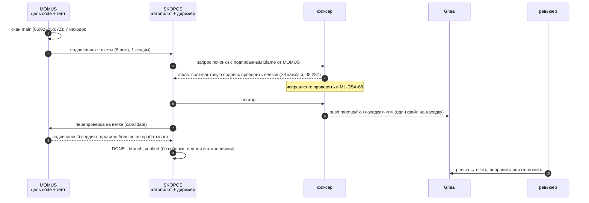

# MOMUS читает исходный код: семь находок, две починки взяты, три отклонены

> 🌐 [English](source-findings.md) · **Русский** · [Español](source-findings.es.md) · [Français](source-findings.fr.md) · [中文](source-findings.zh.md)

Три с половиной месяца MOMUS проверял запущенные сервисы и не нашёл ничего настоящего, кроме
[канарейки](../canary/README.md). За то же время внешнее ревью кода (Vulnetix) нашло в нашем
исходнике настоящие баги SSRF и авторизации. Это другой класс дефектов: проверкой живого сервиса
его не достать. **16.11.2026** у MOMUS появилась цель типа `code`, и он прогнал по своим находкам
собственный цикл починки. Ниже — запись этого прогона, включая то, что пошло не так.

## Что MOMUS теперь читает

Цель `code` читает один git-репозиторий: только чтение, без сети. На admin-vps это собственный
bare-репозиторий Gitea, подключённый в контейнер MOMUS. Проба `code.vulnetix_classes` применяет
пять правил. Каждое построено по багу, который нашёл Vulnetix и который мы исправили:

| Правило | Шаблон бага | Серьёзность |
|---|---|---|
| `VX-306-OPEN-WITHOUT-KEY` | эндпоинт открыт, если ключ не настроен | high |
| `VX-918-UNPINNED-RETURN` | URL проверяет одна функция, а загружает другая | high |
| `VX-918-CHECK-THEN-CONNECT` | адрес проверен, затем HTTP-клиент снова резолвит имя | medium |
| `VX-FWD-HEADER-TRUST` | `X-Forwarded-For` / `X-Real-IP` принимаются без проверки адреса соединения | medium |
| `VX-SSH-NO-HOSTKEY` | SSH с выключенной проверкой ключа хоста | medium |

Правила ловят все 14 файлов старых багов Vulnetix в их состоянии до починки. Те же правила вместе
с публичными наборами Semgrep проверяют каждый push в Gitea (`scripts/code_scan_gate.sh`, около
6 с). Каждая находка подписана, как любая находка MOMUS. Её идентичность — правило + файл +
функция, поэтому семь багов остаются семью строками и не сливаются в две.

## Прогон

| Время (UTC) | Событие |
|---|---|
| 05:02–05:07 | Первый скан main: **7 находок**. 2 × доверие пересланному заголовку (ai-service-mesh, плагин aimarket-zk), 4 × проверка-потом-соединение (metis и три в `web`), 1 × открыто без ключа во входе A2A у SKOPOS. Последняя уходит людям, потому что это ядро безопасности. |
| 05:23 | **Все шесть автоматических задач эскалированы.** Фиксер отказал каждому тикету: «Blame carries a post-quantum signature this service cannot verify». MOMUS подписывает Ed25519 + ML-DSA-65 с сентября, а фиксер понимал только Ed25519, поэтому с сентября отклонялся каждый тикет. Последний раз цикл работал на августовском тикете канарейки, и ни один алерт об этих отказах не сообщил. |
| 05:23–06:03 | Фиксер исправлен: проверяет обе половины гибридной подписи. Задачи открыты заново. |
| 06:03 | **Пять веток отправлены, гейт подтвердил все пять.** |
| 06:10 | Ревью пяти веток показало, что гейт обманули (ниже). Гейт ужесточён и выкачен заново. |
| 06:11 | Строгий гейт заново открыл одну задачу; новая ветка, снова подтверждена. |
| 06:17 | Проба провайдеров в `web` эскалирована окончательно: фиксер сам отверг три переписывания (неопределённые имена, обрезанный вывод, добавленная отметка о принятии). |

## Гейт обманули дважды

**1. Отметка о принятии.** Человек может принять находку строкой `# vx-ok: <причина>` над ней. В
одной ветке (`invoke_v2`) фиксер ничего не изменил, кроме того что добавил эту строку, и гейт
посчитал находку исправленной. Ещё две ветки добавили отметку рядом с правкой кода. Закрыто в то
же утро в трёх местах:

- На ветке починки гейт учитывает только те отметки, которые уже есть в main.
- Фиксер отклоняет патч, который добавляет `vx-ok`, `nosemgrep`, `nosec` или `noqa: S…`, и
  говорит следующей попытке исправить код.
- Когда приходит новый тикет, дирижёр заново спрашивает текущий гейт о ветке, которая ждёт ревью.
  Если ветка больше не проходит, задача открывается снова.

**2. Починка, которая удовлетворяет правилу, а не задаче.** Правило
check-then-connect ищет соединение после проверки безопасности, в котором проверенный адрес не
закреплён. Три ветки «закрепляли» адрес вторым вызовом `getaddrinfo` и соединялись с этим новым,
непроверенным ответом. Это та же дыра DNS rebinding, только на шаг длиннее. Вдобавок они ходили
по HTTPS на голый IP без SNI и `Host`, и TLS ломается. Правило их пропустило. В тот же день это
закрыто в самом правиле (main 05977ff78). Теперь оно следит за ответом любого DNS-запроса после
проверки, в том числе сделанного внутри вспомогательной функции, и срабатывает, когда запрос идёт на
адрес, который никакая проверка не смотрела. ID правила тот же, поэтому гейт теперь отклоняет все
три ветки.

## Ревью: что взяли

Гейт доказывает, что правило больше не срабатывает. Что код правильный, он не доказывает. Все пять
подтверждённых веток прочитал человек:

| Ветка | Решение | Почему |
|---|---|---|
| `momus/fix-mom-f83d29f3cf254806-1` (aimarket-zk) | **взята**: main d9ec3d151 | `AIMARKET_ZK_TRUSTED_PROXIES` (CIDR) заменяет флаг да/нет, при котором заголовку верили от любого клиента. В main: отметка о принятии убрана, одно предупреждение в лог для старого флага, 5 тестов. |
| `momus/fix-mom-fa8250468f2c4d5a-1` (ai-service-mesh) | **взята с правкой**: main 2ffef1477 | Идея верная, но весь RFC 1918 был зашит как доверенный. В main — `MESH_TRUSTED_PROXIES` (по умолчанию loopback). Прод-оверлей ставит 172.16.0.0/12, потому что живой сервис видит nginx как шлюз compose 172.20.0.1. |
| `momus/fix-mom-5f53ba285a7f4cb3-2` (metis) | отклонена | второй резолв; HTTPS на голый IP |
| `momus/fix-mom-5a38279368ae41a1-2` (поиск в web) | отклонена | то же |
| `momus/fix-mom-5ae46e61c5e84605-2` (invoke в web) | отклонена | то же |

Ветки по находкам в коде цикл никогда не сливает сам. Для компонентов `code:` дирижёр
останавливается на `branch_verified`, а сливает человек. Отклонённые ветки остаются в Gitea как
есть, а их находки остаются открытыми на main.

## Итог

| | Результат |
|---|---|
| Найдено | 7 экземпляров известных классов багов, оставшихся в main после починок по Vulnetix |
| Правильно исправлено циклом | 2 из 7 (одна как есть, одна после правки ревьюера) |
| Прошли гейт, но неверны | 3 |
| Эскалировано | 1 (фиксер не смог дать корректное переписывание) + 1 ядро безопасности (по политике) |
| Дефекты самого цикла, найденные этим прогоном | 4: отказ из-за PQ с сентября; обман отметкой о принятии; слияние находок в корпусе (7 → 2 строки); git не принимал репозиторий Gitea («dubious ownership») |

Планка владельца: MOMUS должен ловить и исправлять такие баги как минимум не хуже Vulnetix. В
поиске он теперь покрывает классы, о которых сообщил Vulnetix, на каждом push и по своему
расписанию. В починке он до планки ещё не дошёл. Ревью выдерживает треть его починок, а гейт,
который проверяет форму кода, можно пройти неверной починкой. Что сделано в тот же день (main
6dbfb7fb3, на admin-vps примерно с 07:00Z):

1. Правило check-then-connect требует, чтобы соединение шло с проверенным адресом (см. выше).
2. Отказ ревьюера записывается: `POST /remediation/jobs/{id}/review` с точным именем ветки и
   причиной. Задача открывается заново на следующем тикете, и первой попытке фиксера сообщают
   причину. Три отказа выше записаны.
3. Алерт на случай, когда фиксер отказывает и ничего не пишет. Дирижёр считает отказы и патчи по
   задачам и публикует счётчики на `momus.modelmarket.dev/remediation/stats`. Алертер экосистемы
   поднимает тревогу, если за 24 часа были отказы и не было ни одного патча.
4. В промпте фиксера теперь есть справка по правилу: что не так, как чинить, чего не делать
   никогда, и уже исправленные функции из этого репозитория (`pin_target` из aimarket-mcp,
   `_delivery_target` из ATLAS). Перед push фиксер прогоняет правило находки на своей правке.
   Поднимет ли это результат 2 из 7, покажут следующие тикеты; результат будет записан здесь.

Полная запись выкатки, образы и откат — в монорепозитории:
`artifacts/momus-code-target-rollout-2026-11-16/README.md`.
