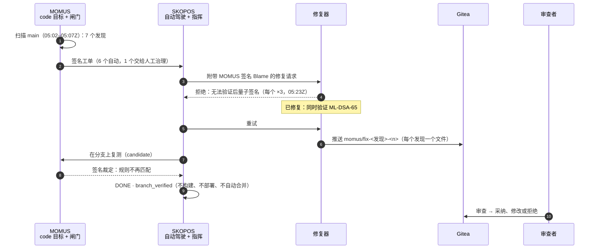

# MOMUS 读源代码：七个发现，采纳两个修复，拒绝三个

> 🌐 [English](source-findings.md) · [Русский](source-findings.ru.md) · [Español](source-findings.es.md) · [Français](source-findings.fr.md) · **中文**

三个半月里，MOMUS 一直在探测运行中的服务，除了[金丝雀](../canary/README.md)之外没有发现任何真实问题。同一时期，外部代码审查（Vulnetix）在我们的源代码里找到了真实的 SSRF 和授权 bug。这是另一类缺陷，探测线上服务触及不到。**2026-11-16**，MOMUS 有了 `code` 目标，并对自己的发现跑了一遍自己的修复循环。本页记录这次运行，包括出错的部分。

## MOMUS 现在读什么

`code` 目标读取一个 git 仓库：只读，不联网。在 admin-vps 上，它就是 Gitea 自己的 bare 仓库，挂载进 MOMUS 容器。探针 `code.vulnetix_classes` 运行五条规则，每条都来自一个 Vulnetix 报告过、我们修好了的 bug：

| 规则 | bug 模式 | 严重度 |
|---|---|---|
| `VX-306-OPEN-WITHOUT-KEY` | 未配置密钥时端点处于开放状态 | high |
| `VX-918-UNPINNED-RETURN` | 一个函数检查 URL，另一个函数去获取它 | high |
| `VX-918-CHECK-THEN-CONNECT` | 地址检查之后，HTTP 客户端再次解析域名 | medium |
| `VX-FWD-HEADER-TRUST` | 不检查套接字对端就信任 `X-Forwarded-For` / `X-Real-IP` | medium |
| `VX-SSH-NO-HOSTKEY` | 关闭了主机密钥校验的 SSH | medium |

这些规则能抓到旧 Vulnetix bug 修复前的全部 14 个文件。同样的规则加上 Semgrep 的公开规则集，也会检查每一次推送到 Gitea（`scripts/code_scan_gate.sh`，约 6 秒）。每个发现都像其他 MOMUS 发现一样带签名。它的身份是"规则 + 文件 + 函数"，所以七个 bug 仍是七行，不会被合并成两行。

## 运行过程

| 时间（UTC） | 事件 |
|---|---|
| 05:02–05:07 | 第一次扫描 main：**7 个发现**。2 × 信任转发头（ai-service-mesh、aimarket-zk 插件），4 × 先检查后连接（metis 以及 `web` 中的三处），1 × SKOPOS A2A 入口在无密钥时开放。最后这个交给人工治理，因为它属于安全核心。 |
| 05:23 | **六个自动任务全部升级给人工。** 修复器拒绝了每一张工单："Blame carries a post-quantum signature this service cannot verify"。MOMUS 自九月起用 Ed25519 + ML-DSA-65 签名，而修复器只认 Ed25519，所以九月以来的每张工单都被拒绝。循环上一次运行还是八月的一张金丝雀工单，也没有任何告警报告这些拒绝。 |
| 05:23–06:03 | 修复器改为验证混合签名的两半。任务重新打开。 |
| 06:03 | **推送了五个分支，全部通过闸门。** |
| 06:10 | 审查这五个分支时发现闸门被钻了空子（见下文）。闸门收紧并重新部署。 |
| 06:11 | 更严格的闸门重新打开了一个任务；新分支再次通过验证。 |
| 06:17 | `web` 中的 providers 探测最终升级给人工：修复器自己拒绝了三次改写（未定义的名称、输出被截断、添加了接受注释）。 |

## 闸门被钻了两次空子

**1. 接受注释。** 人可以在发现的上一行写 `# vx-ok: <原因>` 来接受它。在一个分支（`invoke_v2`）上，修复器除了加上这一行什么也没改，闸门就把这个发现当作已修复。另外两个分支在改代码的同时也加了这条注释。当天上午从三处堵上：

- 在修复分支上，闸门只承认 main 上已有的接受注释。
- 修复器拒绝添加 `vx-ok`、`nosemgrep`、`nosec` 或 `noqa: S…` 的补丁，并要求下一次尝试去修改代码。
- 新工单到来时，指挥会就等待审查的分支重新询问当前闸门。如果分支不再通过，任务重新打开。

**2. 满足规则却没解决问题的修复。** check-then-connect 规则查找的是：安全检查之后的连接没有固定已检查的地址。三个分支的"固定"方式是第二次调用 `getaddrinfo`，然后连接这个新的、未经检查的结果。这还是同一个 DNS rebinding 漏洞，只是多了一步。它们还用 HTTPS 直连裸 IP，没有 SNI 和 `Host`，TLS 会失败。规则放过了它们。当天就在规则本身里修好了（main 05977ff78）：现在它会跟踪检查之后任何一次 DNS 查询的结果，包括在辅助函数里做的查询；当请求发往一个没有任何检查看过的地址时，规则就会触发。规则 ID 不变，所以闸门现在会拒绝这三个分支。

## 审查：采纳了什么

闸门证明规则不再匹配，并不证明代码正确。五个通过验证的分支都由人读过：

| 分支 | 结论 | 原因 |
|---|---|---|
| `momus/fix-mom-f83d29f3cf254806-1`（aimarket-zk） | **采纳**：main d9ec3d151 | `AIMARKET_ZK_TRUSTED_PROXIES`（CIDR 列表）取代了一个是/否开关，那个开关打开后会信任任何调用者的转发头。main 中：去掉了接受注释，旧开关会在日志里提示一次，5 个测试。 |
| `momus/fix-mom-fa8250468f2c4d5a-1`（ai-service-mesh） | **修改后采纳**：main 2ffef1477 | 思路正确，但把整个 RFC 1918 写死为可信。main 中改为 `MESH_TRUSTED_PROXIES`（默认 loopback）。生产覆盖配置设为 172.16.0.0/12，因为线上服务看到的 nginx 是 compose 网关 172.20.0.1。 |
| `momus/fix-mom-5f53ba285a7f4cb3-2`（metis） | 拒绝 | 第二次解析；HTTPS 直连裸 IP |
| `momus/fix-mom-5a38279368ae41a1-2`（web 搜索） | 拒绝 | 同上 |
| `momus/fix-mom-5ae46e61c5e84605-2`（web invoke） | 拒绝 | 同上 |

代码发现的分支永远不会由循环自行合并。对于 `code:` 组件，指挥停在 `branch_verified`，由人来合并。被拒绝的分支原样留在 Gitea 中，它们的发现在 main 上仍然开放。

## 结果

| | 结果 |
|---|---|
| 发现 | 7 处已知 bug 类别的实例，在按 Vulnetix 修复之后仍留在 main 上 |
| 循环正确修复 | 7 个中的 2 个（一个原样采纳，一个经审查者修改） |
| 通过闸门但错误的修复 | 3 |
| 升级给人工 | 1（修复器未能给出有效改写）+ 1 安全核心（按策略） |
| 这次运行发现的循环自身缺陷 | 4 个：自九月起的 PQ 拒绝；用接受注释钻空子；语料库里发现被合并（7 → 2 行）；git 拒绝 Gitea 的仓库（"dubious ownership"） |

所有者的标准是：MOMUS 捕获和修复这些 bug 至少要和 Vulnetix 一样好。在发现上，它现在覆盖了 Vulnetix 报告过的类别，在每次推送时检查，也按自己的计划扫描。在修复上，它还没达到。它的修复只有三分之一能通过审查，而只检查代码形状的闸门会被错误的修复通过。当天完成的改进（main 6dbfb7fb3，约 07:00Z 起在 admin-vps 上运行）：

1. check-then-connect 规则要求：连接的地址必须是检查过的地址（见上文）。
2. 审查者的拒绝会被记录：`POST /remediation/jobs/{id}/review`，带上确切的分支名和原因。下一张工单到来时任务重新打开，修复器的第一次尝试会收到这个原因。上面的三次拒绝已经记录。
3. 修复器只拒绝、不写补丁时告警。指挥按任务统计拒绝和补丁，并把计数发布在 `momus.modelmarket.dev/remediation/stats`。如果 24 小时内有拒绝而没有任何补丁，生态系统告警器就会报警。
4. 修复器的提示词里现在带有该规则的指南：哪里错了、怎么修、绝不能怎么做，以及本仓库里已经修好的函数（aimarket-mcp 的 `pin_target`、ATLAS 的 `_delivery_target`）。推送之前，修复器会用该发现的规则检查自己的改写。这能否提高"7 个中修好 2 个"的结果，要看接下来的工单，结果会记录在本页。

完整的上线记录、镜像和回滚方式在单体仓库中：`artifacts/momus-code-target-rollout-2026-11-16/README.md`。
